# BANDIT

Men o`zim ishlab chiqgan bandit saytdagi masalalarning ishlanishini berib o`taman.

[https://overthewire.org/wargames/bandit/bandit0.html](https://overthewire.org/wargames/bandit/bandit0.html)

Birinchi shu saytga kirib olamiz. Shunday oyna ochiladi.

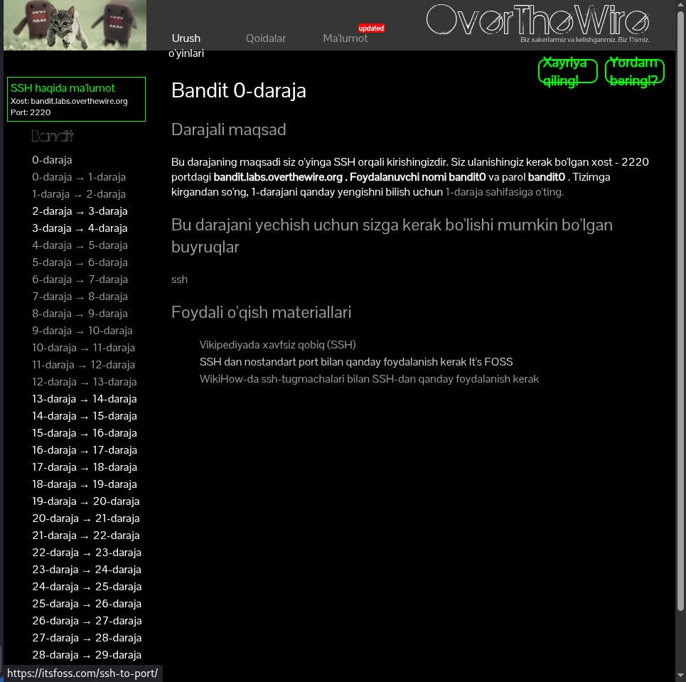

                   Bandit0→Bandit1

Bizga Bandit0→Bandit1 o`tish sharti berilgan.

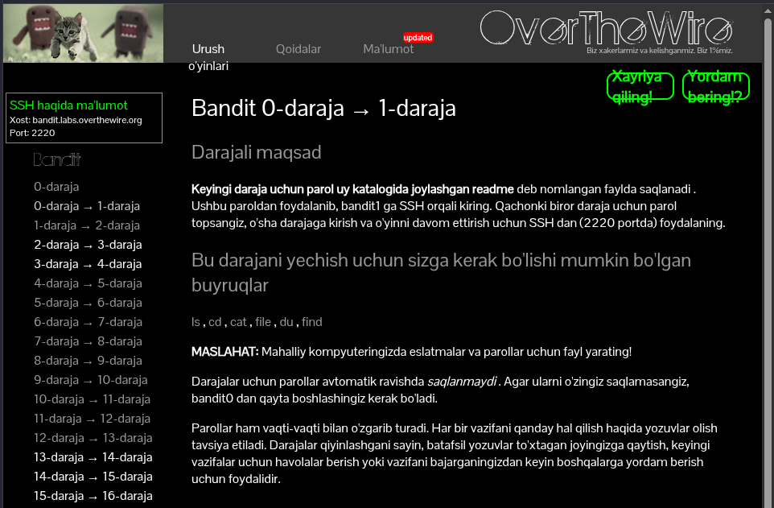

Keyin biz kali terminalini ochib, shu kodni kiritamiz. Bu bandit ulanib olish uchun zarur.

```jsx
ssh bandit0@bandit.labs.overthewire.org -p 2220

```

Keyin bizdan parol so`raydi, paroli bandit0. Keyin bizda shunday oyna yechimini ko`rishingiz mumkin.

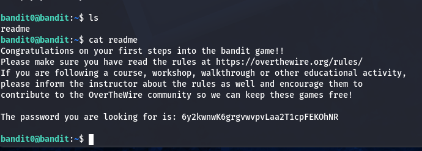

```jsx
ls
cat readme
```

Biz keyingi bo`limga o`tish yaniy bandit1 o`tish paroli

```jsx
6y2kwnwK6grgvwvpvLaa2T1cpFEKOhNR
```

        Bandit1→ Bandit2

Bizga Bandit1→Bandit2 o`tish sharti berilgan.

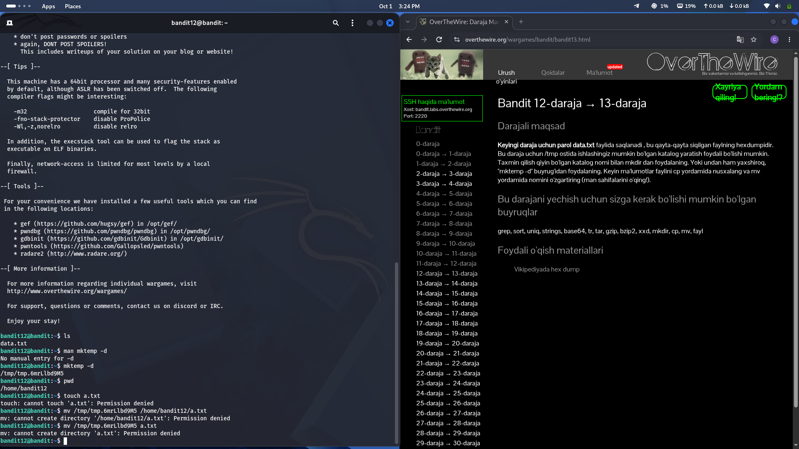

Biz kali terminali orqali bandit1 ga ulanish.

```jsx
ssh bandit1@bandit.labs.overthewire.org -p 2220
```

Biz ushbu kodni kiritsak, bizda ham shunday natija chiqadi.

```jsx
ls
pwd
cat ./-
```

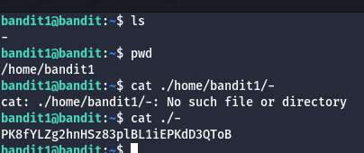

Keyingi bandit2 ga o`tish parolini ko`rishimiz mumkin.

```jsx
K8fYLZg2hnHSz83plBL1iEPKdD3QToB
```

           BANDIT2 → BANDIT3

Bizga bandit2 ning shartini ko`rishimiz mumkin.

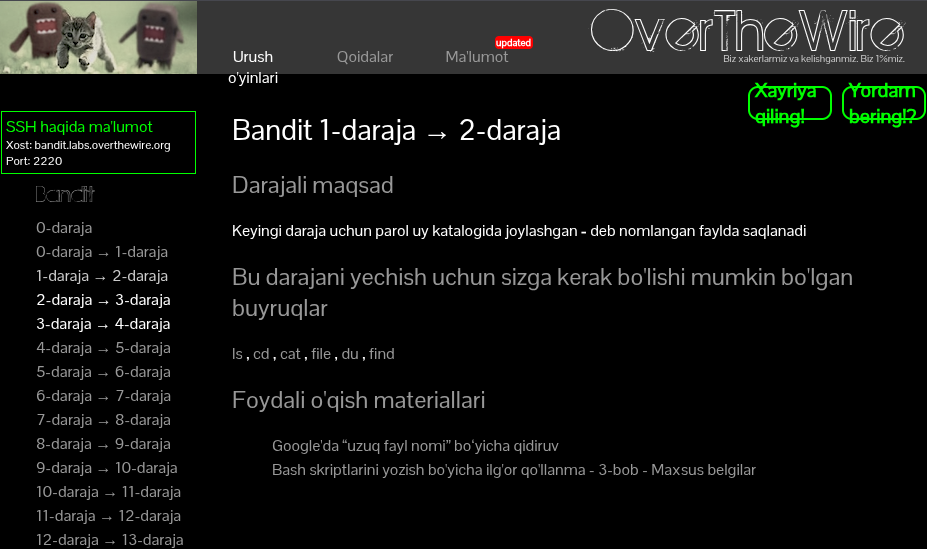

Bizga berilgan shartdan foydalanib, keyingi bo`limni ishlashimiz mumkin.

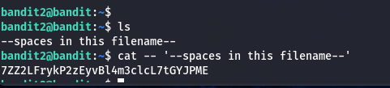

bu ishlatilgan kodlar,  parol:   7ZZ2LFrykP2zEyvBl4m3clcL7tGYJPME

```jsx
pwd
ls
cat -- '--spaces in this filename--'
```

         BANDIT3 →BANDIT4

Bandit3 ning shartini qarab, ishlashga kirishamiz.

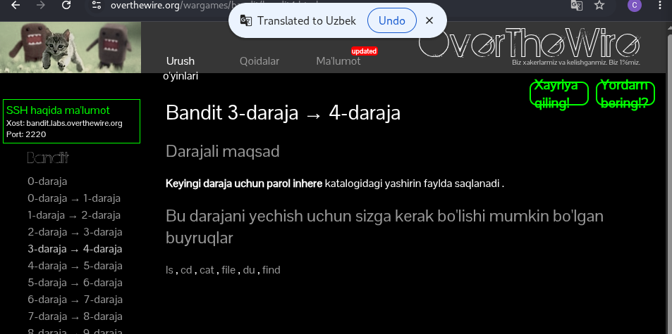

Men berilgan shartdan foydalanib, shu yechimga erishdim.

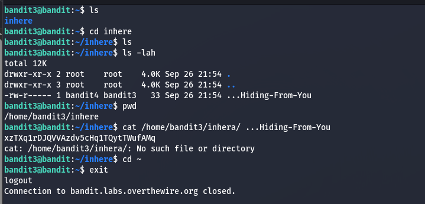

ishlash kodi yozsak, shu BANDIT3 → BANDIT4 ga o`tish paroli kelib chiqadi. Parol: xzTXq1rDJQVVAzdv5cHq1TQytTWufAMq

```jsx
ls
cd inhere
ls
ls -lah
pwd
cat /home/bandit3/inhere/...Hiding-From-You
cd ~
exit
```

       BANDIT4 →BANDIT5 

Bandit4 ning ishlash shartini yaxshilab o`qib yechishga kirishamiz.

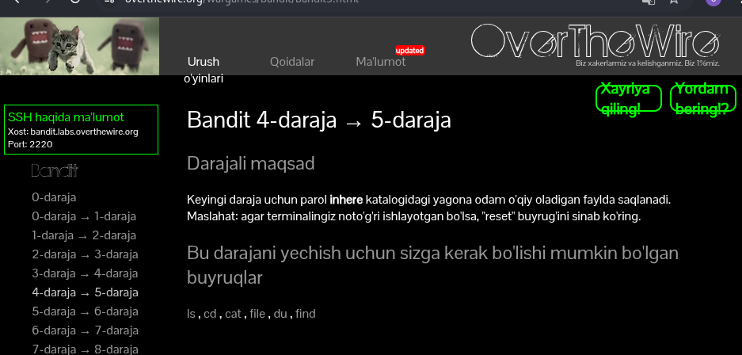

Shartni to`liq o`rganib, yechishga kirishamiz.

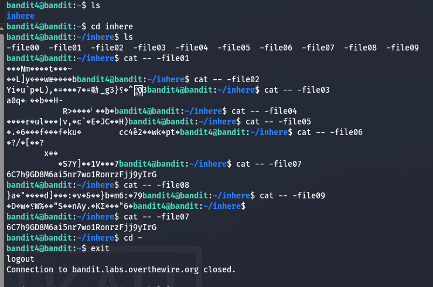

Shular orasida kerakli kodlarni ajratib, yozib berdim.Bunda -file07 oldindagi — belgi rekursivlikni bildiradi.

```jsx
ls
cd inhere
ls
cat -- -file07
cd ~
exit
```

Shu kodlarni kiritsak, biz erishgan parol: 6C7h9GD8M6ai5nr7wo1RonrzFjj9yIrG

         BANDIT5 → BANDIT6

Bandit5 ning shartidan skrenshoot.

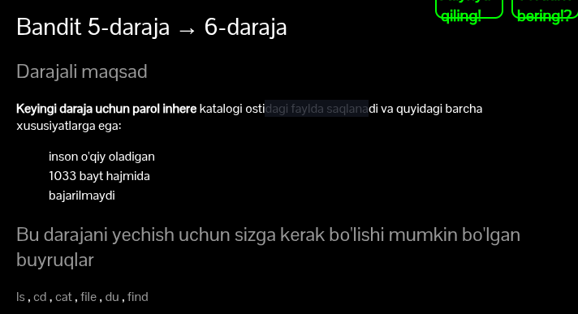

Bizga berilgan ma`lumotga qarasak, parol saqlanggan faylning hajmi berilgan shu hajm orqali find yordamida fayl qidirib olamiz.

```jsx
find / -size 1033c 2> /dev/null
cat /home/bandit5/inhere/maybehere07/.file2

```

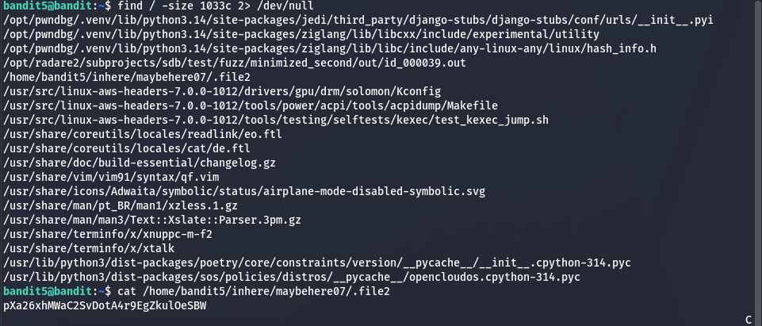

Men nega aynan /home/bandit5/inhere/maybehere07/.file2 tanlaganim sababi, bandit5 ichida inhere va maybehere07 papkalari borligi.

Bandit5 → bandit6 ga o`tish paroli: pXa26xhMWaC2SvDotA4r9EgZkulOeSBW

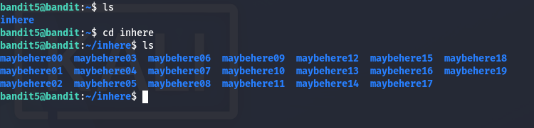

     BANDIT6 → BANDIT7

Bu masalamiz ham oldingiga o`xshash ekan.

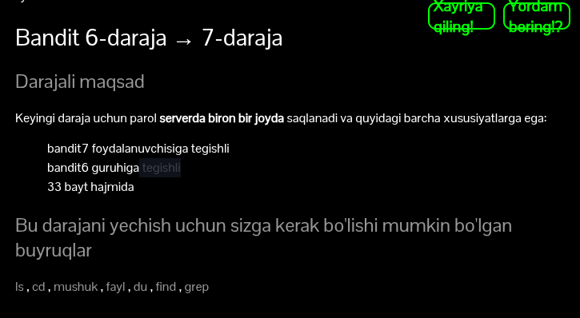

ushbu shartdan foydalanib, men shu kodlarni kiritdim.

```jsx
find / -size 33c 2> /dev/null
cat /var/lib/dpkg/info/bandit7.password
```


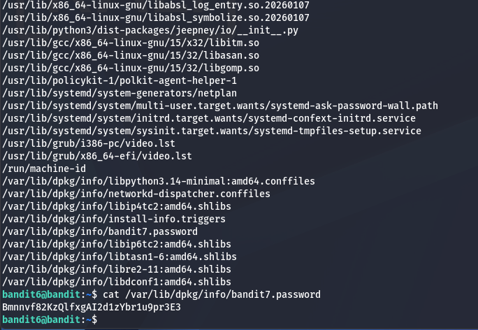

Izlanishim orqasidan bandit6 → bandit7 ga o`tish paroli: Bmnnvf82KzQlfxgAI2d1zYbr1u9pr3E3
   BANDIT7 →BANDIT8

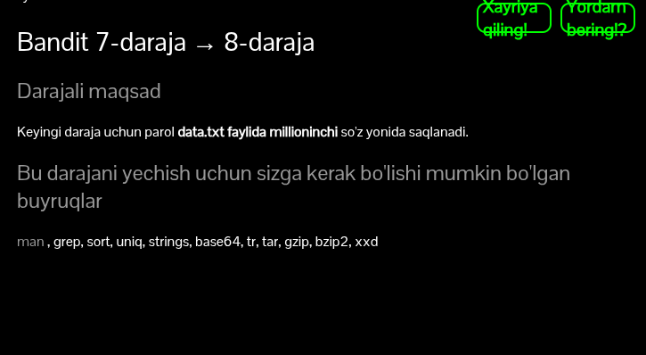

Bizga aytilgan shartga ko`ra men data.txt fayl ichidan millioninchi dan keyingi so`zni qidirdim.

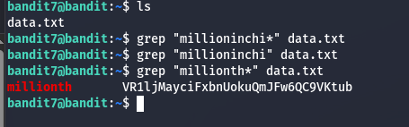

Faqat bitta sharti millioninchi so`zini asliday olish kerak ekan. 

bandit7 → bandit8 ga o`tish paroli: VR1ljMayciFxbnUokuQmJFw6QC9VKtub
  BANDIT8 → BANDIT9

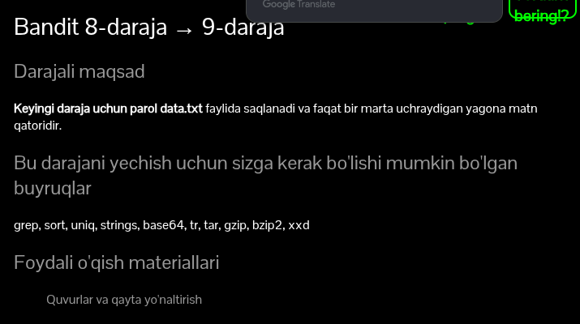

Mening fikrimcha eng oson masala manashu bo`lsa kerak.shartdan foydalanib ushbu bir qator kodni yozsak bas.

```jsx
cat data.txt | sort | uniq -u
```

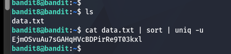

Bandit8 → Bandit9 o`tish paroli: EjmOSvuAu7sGAHqHVcBDPirRe9T03kxl

   BANDIT9 → BANDIT10

 

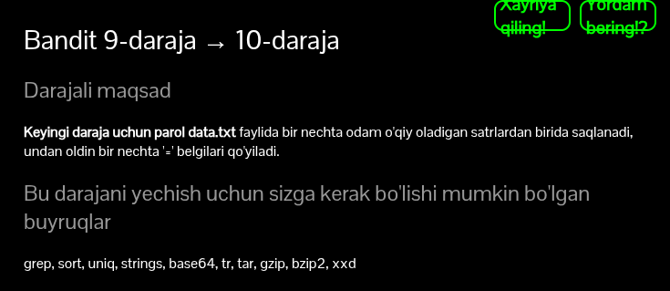

Shartdagi foydalanib, unga shu kodni kiritsak chiqadi.

```jsx
strings data.txt
```

Bandit9 → Bandit10 ga o`tish paroli:  B0s2khmbT9u0geKuOoVGW3JZKhndE3BG

BANDIT10 → BANDIT11

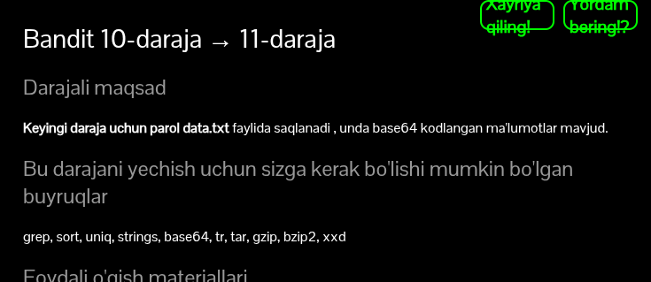

Bundan ma`lumki, bizning parol data.txt faylda faqat base64 kodlangan shaklda turibdi.

```jsx
cat data.txt
echo 'VGhlIHBhc3N3b3JkIGlzIHBZZk9ZNkh3VXNEajVyTDlVdnloVTdNQ212OHZONVJvCg==' | base64 -d

```


Bandit10 → Bandit11 ga o`tish paroli:  pYfOY6HwUsDj5rL9UvyhU7MCmv8vN5Ro

BANDIT11 → BANDIT12


Men data.txt ichidagi matnni Vikipediyada Rot13 ko`rib ushbu koddan foydalanish kerakligini bildim.

```jsx
cat data.txt | tr 'A-Za-z' 'N-ZA-Mn-za-m'

```

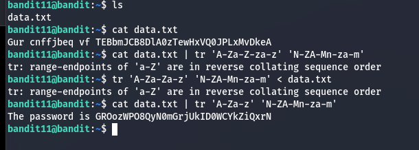

Bandit11 →Bandit12 o`tish paroli: GROozWPO8QyN0mGrjUkID0WCYkZiQxrN